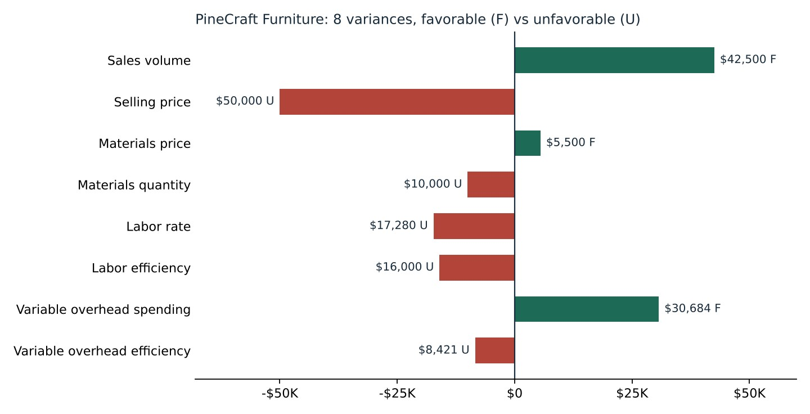

# Excel & Financial Analysis

**Finley Hardie** · University of Denver, Daniels College of Business
Portfolio site: **[finleyhardie-bit.github.io](https://finleyhardie-bit.github.io)**

Accounting and financial analysis coursework. This is the same budget-vs-actual and financial-statement thinking I use in affordable-housing asset management.

| Folder | What's inside |
|---|---|
| [`pinecraft-variance-analysis/`](pinecraft-variance-analysis) | Flexible budget and 8-variance analysis, presented to a mock board |
| [`crocs-10k-analysis/`](crocs-10k-analysis) | Two-year analysis of Crocs' 10-K filings |

---

## PineCraft Furniture: variance analysis
Managerial Accounting, Spring 2026 · Team project

PineCraft planned to sell 950 custom oak dining tables but made and sold 1,000. Comparing actual results to the original plan mixes up two effects: selling more units, and paying more or less per unit.

- **My part:** I built the Excel model. I rebuilt the budget at the actual 1,000 units using standard costs (a flexible budget) and split the gap into 8 variances: sales volume, selling price, materials price and quantity, labor rate and efficiency, and variable overhead spending and efficiency.
- Our team presented the causes and a management response to the board of directors.

**Key finding:** extra volume ($42.5K favorable) and lower overhead spending ($30.7K favorable) hid a $50K unfavorable price cut and about $33K of unfavorable labor variances.

Files: [`pinecraft-variance-model.xlsx`](pinecraft-variance-analysis/pinecraft-variance-model.xlsx) · [`pinecraft-board-presentation.pdf`](pinecraft-variance-analysis/pinecraft-board-presentation.pdf)

## Crocs (CROX) 10-K comparative analysis
ACTG 2200 Introduction to Financial Reporting, Winter 2026 · Individual project

- Walked through every section of the 10-K and what it tells an investor.
- Calculated year-over-year trends, margins, and liquidity and profitability ratios for FY2023 vs. FY2024.
- Reported EPS rose from $8.82 to $16.00. I explained the drivers behind it.

File: [`crocs-10k-analysis.pdf`](crocs-10k-analysis/crocs-10k-analysis.pdf)

**Tools:** Excel, SEC EDGAR filings, PowerPoint
